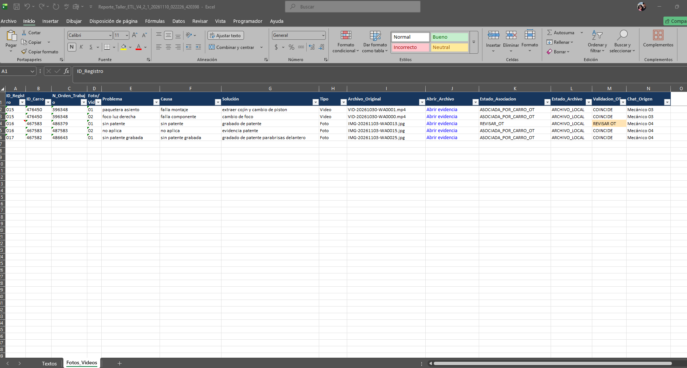

# Sistema ETL y reportería operacional — Taller de Buses

**Proyecto de portafolio | Prototipo y pruebas piloto | 2026**

## Resumen ejecutivo

Desarrollo de un flujo de extracción, transformación, validación y consolidación (ETL) destinado a ordenar registros operativos de mantenimiento de buses y facilitar su seguimiento mediante reportes. El proyecto integra herramientas de automatización y bases de datos para reducir la fragmentación de la información y apoyar la identificación de órdenes de trabajo pendientes, inconsistencias y oportunidades de facturación.

> **Alcance:** Este repositorio presenta una demostración del proyecto. Las pruebas descritas no equivalen a una implantación productiva completamente validada ni a resultados económicos comprobados. No se publican conversaciones, evidencias, credenciales ni datos reales de trabajadores o clientes.

## Problema de negocio

Los reportes operacionales se encontraban dispersos en distintos mensajes y evidencias, dificultando consolidar la información por orden de trabajo (OT), dar seguimiento al estado de las actividades y preparar reportes para gestión y facturación.

## Objetivo

Diseñar un proceso trazable que permita organizar registros asociados a OT, relacionar textos y evidencias, detectar inconsistencias y generar información útil para seguimiento operacional.

## Tecnologías utilizadas

- **Python:** transformación y validaciones del proceso ETL.
- **SQLite:** registros de control y trazabilidad.
- **Excel / Google Sheets:** consolidación y reportes de gestión.
- **Google Apps Script / Google Drive:** integración y asociación de evidencias.
- **PowerShell:** ejecución local de procesos y automatización del flujo.

## Flujo general

```text
Registros operacionales y evidencias
                 |
                 v
         Extracción y lectura
                 |
                 v
      Normalización y validación
                 |
                 v
       Asociación por OT / IDs
                 |
                 v
       Consolidación y controles
                 |
                 v
        Reportes y seguimiento
```

## Controles considerados

- Identificación de órdenes de trabajo (OT).
- Asociación entre registros de texto y evidencias.
- Controles de integridad de identificadores.
- Detección y reporte de inconsistencias operacionales.
- Preparación de información para seguimiento y revisión humana.

## Pruebas realizadas

- **Validación del prototipo V4.2.1:** revisión de ocho identificadores, sin errores detectados en esa prueba.
- **Prueba piloto:** extracción de registros con tres mecánicos.
- **Auditoría sintética de ejemplo:** 180 OT y 591 líneas, usadas para ensayar controles de datos.

Estas cifras corresponden a ejercicios o pruebas puntuales y no constituyen métricas generales de producción.

## Estado y límites

Se desarrolló un prototipo funcional y se realizaron pruebas piloto. Queda pendiente documentar públicamente la ejecución reproducible del entorno demostrativo, verificar dependencias y seleccionar código publicable. Cualquier resultado operativo o financiero real deberá confirmarse por separado.

## Contenido del repositorio

| Ruta | Propósito |
|---|---|
| `docs/` | Arquitectura, descripción del caso de negocio y criterios de validación |
| `capturas/` | Imágenes de la demostración, sin datos sensibles |
| `demo/` | Datos sintéticos y guía de ejecución |
| `src/` | Código demostrativo revisado para publicación |

## Próximos pasos

1. Seleccionar capturas con datos ficticios.
2. Crear un conjunto de datos sintético reproducible.
3. Revisar y sanitizar el código demostrativo.
4. Documentar pasos de ejecución y resultados esperados.


## Nota de privacidad

El material original del taller, incluidas conversaciones, fotos, videos, identificadores y credenciales, queda fuera de este repositorio. La versión pública usará únicamente datos sintéticos y materiales aptos para difusión.


## Evidencia visual del sistema

### Reporte ETL y validación de órdenes de trabajo

La siguiente captura corresponde al entorno demostrativo del proyecto y muestra cómo el sistema consolida información operacional, vincula evidencias y aplica controles de validación sobre órdenes de trabajo.

El campo `Validacion_OT` permite identificar registros que requieren revisión, mientras que `Estado_Asociacion` documenta el resultado de la vinculación de evidencias.



*Figura 1. Salida del ETL V4.2.1 en Excel con datos demostrativos.*
